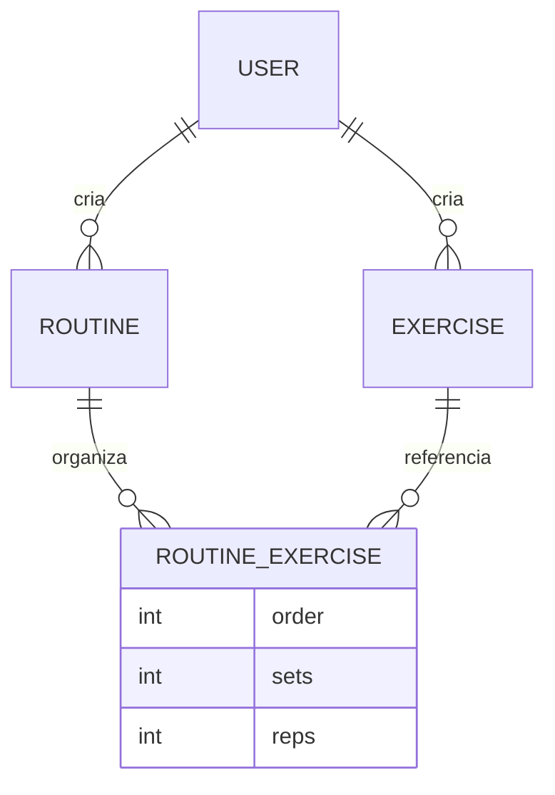

# Overload

**API REST para organizar exercícios e montar rotinas de treino personalizadas.**

O Overload é um projeto backend desenvolvido em C# e ASP.NET Core. Usuários podem criar uma conta, manter seu catálogo de exercícios e organizar esses exercícios em rotinas semanais, com séries, repetições e ordem de execução.

[](https://dotnet.microsoft.com/)
[](https://learn.microsoft.com/dotnet/csharp/)
[](https://www.postgresql.org/)
[](./overload/LICENSE)

## Destaques técnicos

Uma API construída com atenção a regras de domínio, segurança e organização:

- autenticação stateless com JWT e senhas protegidas com BCrypt;
- autorização por proprietário: exercícios e rotinas são acessados no contexto do usuário autenticado;
- regras de domínio para evitar nomes repetidos, exercícios duplicados em uma rotina e associações entre usuários diferentes;
- persistência relacional com Entity Framework Core, PostgreSQL e migrations;
- validação de dados de entrada e tratamento de exceções com `ProblemDetails`;
- testes automatizados dos serviços usando SQLite em memória, sem exigir PostgreSQL para executar a suíte.

## Funcionalidades

- Cadastro de usuários com validação e verificação de nome de usuário/e-mail duplicados.
- Login com nome de usuário **ou** e-mail e emissão de token JWT com validade de 60 minutos.
- Consulta de informações da conta autenticada.
- Criação, listagem, atualização parcial e exclusão de exercícios próprios.
- Criação e listagem de rotinas próprias.
- Inclusão de exercícios próprios em uma rotina própria, com séries, repetições e posição.
- Consulta dos exercícios de uma rotina em ordem de execução.
- Enums de domínio serializados como texto, como `Chest`, `FreeWeight` e `Monday`.
- Visibilidade configurável para exercícios e rotinas.

## Tecnologias

| Área | Tecnologias |
| --- | --- |
| API | C#, ASP.NET Core 10 |
| Persistência | Entity Framework Core 10, PostgreSQL, Npgsql |
| Autenticação | JWT Bearer, BCrypt |
| Testes | xUnit, Moq, SQLite em memória |
| Chamadas manuais | Coleção Bruno em [`bruno/overload_csharp`](./bruno/overload_csharp) |

## Como executar

### Pré-requisitos

- [.NET 10 SDK](https://dotnet.microsoft.com/download)
- PostgreSQL em execução
- `dotnet-ef` instalado globalmente para aplicar migrations (`dotnet tool install --global dotnet-ef`), caso ainda não esteja disponível

### Configurar conexão e chave JWT

Configure as variáveis de ambiente antes de iniciar. Exemplo no PowerShell:

```powershell
$env:ConnectionStrings__PostgresConnection = "Host=localhost;Port=5432;Database=overload_db;Username=postgres;Password=sua-senha"
$env:AuthConfiguration__Key = "substitua-por-uma-chave-aleatoria-com-pelo-menos-32-caracteres"
```

No Bash:

```bash
export ConnectionStrings__PostgresConnection="Host=localhost;Port=5432;Database=overload_db;Username=postgres;Password=sua-senha"
export AuthConfiguration__Key="substitua-por-uma-chave-aleatoria-com-pelo-menos-32-caracteres"
```

Configure credenciais e uma chave aleatória próprias para cada ambiente. As variáveis de ambiente sobrescrevem os valores de configuração; mantenha segredos fora do versionamento.

### Restaurar, criar o esquema e iniciar

Na raiz do repositório:

```powershell
dotnet restore .\overload\overload-csharp.csproj
dotnet ef database update --project .\overload\overload-csharp.csproj
dotnet run --project .\overload\overload-csharp.csproj --launch-profile http
```

O perfil `http` inicia a API em `http://localhost:5071`. O endereço e os perfis de execução estão definidos em [`launchSettings.json`](./overload/Properties/launchSettings.json).

## API

Todas as rotas começam com `/api`. As rotas marcadas como protegidas exigem:

```http
Authorization: Bearer <token>
```

Obtenha um token em `POST /api/Auth/login`. A autorização associa as operações aos recursos pertencentes ao usuário autenticado.

| Método | Rota | Acesso | Descrição |
| --- | --- | --- | --- |
| `GET` | `/api/User` | Público | Retorna uma mensagem da API |
| `POST` | `/api/User` | Público | Cadastra um usuário |
| `POST` | `/api/Auth/login` | Público | Autentica com nome de usuário ou e-mail |
| `GET` | `/api/User/info` | JWT | Retorna nome de usuário e ID autenticado |
| `POST` | `/api/exercises` | JWT | Cria um exercício |
| `GET` | `/api/exercises` | JWT | Lista os exercícios do usuário |
| `PATCH` | `/api/exercises/{exerciseId}` | JWT | Atualiza parcialmente um exercício próprio |
| `DELETE` | `/api/exercises/{id}` | JWT | Exclui um exercício próprio |
| `POST` | `/api/routines` | JWT | Cria uma rotina |
| `GET` | `/api/routines` | JWT | Lista as rotinas do usuário |
| `POST` | `/api/routines/{routineId}/exercises` | JWT | Adiciona um exercício próprio à rotina |
| `GET` | `/api/routines/{routineId}/exercises` | JWT | Lista os exercícios da rotina em ordem |

### Exemplo de fluxo

Cadastre um usuário:

```http
POST /api/User
Content-Type: application/json

{
  "firstName": "Ana",
  "lastName": "Silva",
  "username": "ana.silva",
  "email": "ana@example.com",
  "password": "senha-com-pelo-menos-8-caracteres",
  "birthDate": "1998-04-12"
}
```

Autentique-se informando **um** identificador (nome de usuário ou e-mail):

```http
POST /api/Auth/login
Content-Type: application/json

{
  "username": "ana.silva",
  "email": "",
  "password": "senha-com-pelo-menos-8-caracteres"
}
```

A resposta contém `token` e `tokenType` (`Bearer`). Use o token nas chamadas protegidas.

Crie um exercício:

```http
POST /api/exercises
Authorization: Bearer <token>
Content-Type: application/json

{
  "name": "Supino reto",
  "muscle": "Chest",
  "type": "FreeWeight",
  "isPublic": false
}
```

Grupos musculares aceitos: `Chest`, `Back`, `Shoulders`, `Biceps`, `Triceps`, `Forearms`, `Abs`, `Quads`, `Hamstrings`, `Glutes` e `Calves`. Tipos de exercício: `Machine`, `FreeWeight`, `Bodyweight` e `Cable`.

Crie uma rotina e inclua nela um exercício do mesmo usuário:

```http
POST /api/routines
Authorization: Bearer <token>
Content-Type: application/json

{
  "name": "Treino A",
  "day": "Monday",
  "isPublic": false
}
```

```http
POST /api/routines/10/exercises
Authorization: Bearer <token>
Content-Type: application/json

{
  "exerciseId": 17,
  "order": 1,
  "sets": 4,
  "reps": 10
}
```

`order: 0` adiciona o exercício ao final da rotina; uma posição positiva permite colocá-lo naquela posição. Séries aceitam valores de 1 a 50, e repetições de 1 a 500.

Consulte a rotina:

```http
GET /api/routines/10/exercises
Authorization: Bearer <token>
```

## Arquitetura

O código separa a camada HTTP, regras de aplicação, contratos da API, domínio e persistência:

```text
overload/
├── Controllers/   # Endpoints e tradução de resultados HTTP
├── Services/      # Regras de usuário, autenticação, exercícios e rotinas
├── DTOs/          # Contratos de entrada e saída
├── Entities/      # Entidades e enums do domínio
├── Data/          # DbContext e configurações do Entity Framework Core
├── Migrations/    # Histórico de evolução do esquema
├── Exceptions/    # Tratamento global e erros da API
├── Extensions/    # Integração entre resultados e respostas HTTP
└── Utils/         # Geração e validação de tokens JWT

overload.Tests/    # Testes automatizados dos serviços
bruno/             # Coleção Bruno para chamadas HTTP manuais
```

Modelo central:



`RoutineExercise` representa a associação entre uma rotina e um exercício e guarda os dados específicos daquele treino: posição, séries e repetições.

## Testes

Execute os testes a partir da raiz:

```powershell
dotnet test .\overload.Tests\overload.Tests.csproj
```

**29 testes aprovados** na execução mais recente. A suíte exercita validação e cadastro de usuários, autenticação por e-mail ou nome de usuário, regras de autoria e operações de exercícios e rotinas. A infraestrutura usa SQLite em memória, sem exigir PostgreSQL para testar.

## Coleção Bruno

Importe [`bruno/overload_csharp`](./bruno/overload_csharp) no Bruno para experimentar chamadas da API. A coleção usa `localhost:5071`; inicie o perfil `http` e use o token obtido no login nas requisições protegidas.

## Sobre o projeto

O Overload reúne autenticação, catálogo de exercícios e planejamento de rotinas em uma API .NET com persistência relacional e regras de acesso por usuário. O projeto demonstra uma base consistente para evoluir um produto de treino, da modelagem do domínio às chamadas HTTP e aos testes automatizados.

## Licença

Este projeto está sob a licença [MIT](./overload/LICENSE).
